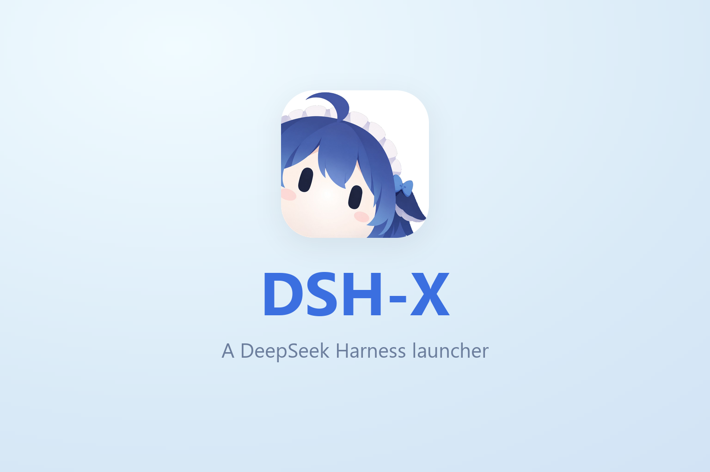
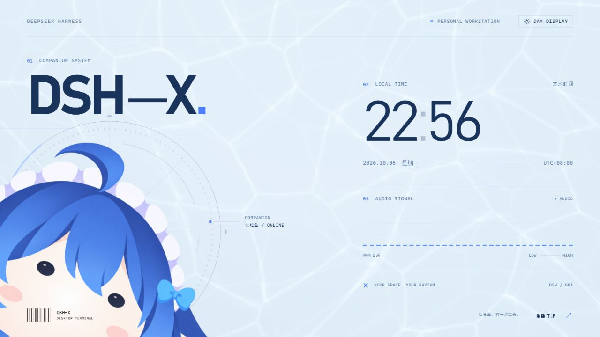

<p align="center">
  
</p>

<p align="center">
  A <a href="https://github.com/deepseek-ai/deepseek-harness">DeepSeek Harness</a> launcher (dsh launcher) —<br />
  launch entries and multiple instances, version, plugin, instance, MCP and skill management.
</p>

<p align="center">
  
  
  
</p>

<p align="center">
  <a href="https://github.com/yyh-001/DSH-X/releases">
    
  </a>
  <a href="https://www.npmjs.com/package/@yyh001/dsh-x">
    
  </a>
  
  <br>
  
  
  
</p>

<p align="center">
  <samp><a href="https://yyh-001.github.io/DSH-X/">Website</a> · <a href="https://github.com/yyh-001/DSH-X/releases/latest">Download</a> · <a href="docs/releases">Changelog</a> · <a href="CONTRIBUTING.en.md">Contributing</a> · <strong>English</strong> · <a href="README.md">中文</a></samp>
</p>

> [!IMPORTANT]
> **DSH-X starts DeepSeek Harness's own web page.**
> It only handles version installation, launching and plugin management and never modifies or rewrites DSH's web UI. DSH-X is a community project, not an official DeepSeek product.

## Features

- 🚀 **Launch entries and multiple instances** — choose a home directory, profile, version and port per entry; start entries concurrently and add entries while DSH is running.
- 📦 **Version management** — a dedicated manager for detecting new releases, manually installing, removing, checking disk usage and assigning versions to launch entries.
- 🧩 **Plugins and instances** — instances lock a DSH version and plugin versions, and can be imported, exported and updated from an upstream; plugins are toggled per profile, with configurable default indexes for the official custom plugin market.
- 🖥️ **Desktop enhancements** — tick it when adding a launch item to install three first-party plugins (native notifications, context menu, sidebar browser) into the instance that launch item uses; add missing ones later by editing the launch item, then toggle or update them individually on the Plugins page.
- 🛠️ **MCP and skills** — configure MCP servers and import, manage and toggle skills.
- 🪟 **Opening modes** — tabs inside DSH-X, a system browser tab, a standalone browser window or a desktop window.
- 🎨 **Appearance** — light / dark themes, transparency, opening and launch-entry animations, and separate background and Big Fish switches.
- 🔄 **Updates and recovery** — self-update, profile recovery, profile backups and rollback, plus configurable old-version retention; each launch entry's current and previous versions are kept additionally.
- 🔍 **Startup troubleshooting** — the launch log has three tabs (raw log / time breakdown / disk usage) and plugin diagnostics on the raw log page: startup time and dependencies rolled up per plugin, native/GC detail, and disk usage split into plugin code, dependencies, runtime and config/data; the log icon turns red when a plugin errors.
- ⚙️ **Desktop system switches** — hardware acceleration, automatic update download (install manually), task notifications and sound, hide to tray on close, and keep-awake.
- 💻 **Windows / macOS / Linux** — installers for all three platforms, tray / menu bar operation and launch at login, plus bundled npm / pnpm wrappers.

## Getting started

Download the installer for your platform from [Releases](https://github.com/yyh-001/DSH-X/releases/latest):

| Platform | Requirements | Installer |
| --- | --- | --- |
| Windows | Windows 10 or later, x64 | `DSH-X-<version>-win-x64.exe` (NSIS) |
| macOS | macOS 13 or later | `DSH-X-<version>-mac-arm64.dmg` (Apple Silicon) / `DSH-X-<version>-mac-x64.dmg` (Intel) |
| Linux | x64; AppImage needs FUSE | `DSH-X-<version>-linux-x64.AppImage` / `DSH-X-<version>-linux-x64.deb` |

> [!NOTE]
> The installer ships only the shell and Electron; the core is not bundled. The first launch needs network access: it downloads the current channel's `dsh-x-core` from npm and shows live progress and the download source. Later core updates also come from npm.

### Windows

Download `DSH-X-<version>-win-x64.exe`, install it and open **DSH-X** from the desktop. The installer has no Authenticode signature, so SmartScreen may show an "unknown publisher" prompt — see [Signing and antivirus false positives](#signing-and-antivirus-false-positives).

### macOS

Open the dmg and drag **DSH-X** into Applications. The package is ad-hoc signed and not notarized, so the first launch may require manual approval through macOS security prompts; if macOS says the app is damaged or cannot verify the developer, right-click Open, or run:

```sh
xattr -dr com.apple.quarantine /Applications/DSH-X.app
```

Shell auto-update is currently unavailable, while core updates still come from npm.

### Linux

Download `DSH-X-<version>-linux-x64.AppImage`, `chmod +x` it and run it. If FUSE is unavailable, use `./DSH-X-<version>-linux-x64.AppImage --appimage-extract-and-run`.

On Debian / Ubuntu you can also install the deb: it lands in `/opt/DSH-X`, adds a menu entry and uninstalls with `apt remove dsh-x`, but **the deb build has no shell auto-update** — grab the new installer from the releases page:

```sh
sudo apt install ./DSH-X-<version>-linux-x64.deb
```

Settings live in `~/.config/DSH` and the core cache in `~/.cache/dsh-x`; core updates use npm for both packages.

### Verifying a download

The releases page lists a sha256 next to every file — compare it locally:

```sh
certutil -hashfile DSH-X-<version>-win-x64.exe SHA256     # Windows
shasum -a 256 DSH-X-<version>-mac-arm64.dmg              # macOS
sha256sum DSH-X-<version>-linux-x64.AppImage             # Linux
```

## Usage

- Add or edit a launch entry on the home page, select its instance and profile, then start it. Open **Version management** from the launch-entry editor to manually install or remove versions.
- Settings → General → **How dsh opens** offers internal tabs, a browser or a separate window. Internal tabs require the installed desktop app.
- The manager defaults to port `3780` and tries the next port if occupied.
- To reach dsh from another device: Settings → Advanced → **Web binding** → LAN, applied on the next start.

### Adding a launch entry

Pick an **isolation mode** first; it decides how far the new profile is from the existing ones:

| Isolation | Created in | Shared |
| --- | --- | --- |
| Plugin isolation (default) | A new profile inside the global dsh directory | Sessions, memories, skills; plugins and config separate |
| Session isolation | A new user directory under `homes/<name>` in the data directory | Nothing: sessions, skills and plugins are all separate |
| Custom | A user directory + profile + port of your choice | Whatever that directory and profile already have |

In the first two modes, then pick where the **profile** comes from:

- **New profile**: leave the name empty to have one generated (collisions get a suffix), or type your own.
- **Copy an existing profile**: choose the source (directory on the left, profile in the middle); the new name defaults to `source-copy` and can be changed.

What gets copied is the **profile**, not the whole user directory: `package.json`, `cordis.patch.yml`, plugin switches and MCP settings come along,
dependencies are reinstalled from their version ranges (not copied from `node_modules`), and the user-level `skills`, Prompt settings, per-plugin data directories and session history are not.
Local `file:` / `link:` / `portal:` dependencies are rewritten for the new location; paths pointing outside the source directory are left as-is, so that workspace must still exist.

### Troubleshooting a launch

The launch log dialog has three tabs, shown only when data was collected: **Raw log** is always there, **Time breakdown** groups startup time by plugin (shared dependencies are split across the plugins that use them), and **Disk usage** splits the footprint into plugin code, plugin dependencies, runtime, runtime dependencies, and config & data. The raw log page also shows **Plugin diagnostics** at the top: which plugin is incompatible, where startup failed, and any repair plan. When a plugin errors, the log icon on the launch entry turns red.

### Plugins and profiles

- The **+** button on the Plugins page adds a plugin by npm package name, local absolute path or Git URL; installing and removing keeps the bundle layer stack and dependencies in sync.
- The home plugin dialog's **More actions** menu has **Profile backups & rollback**: a config-layer snapshot is saved before each launch, and you can also click **Back up now**. Restoring reinstalls dependencies from the restored manifest and requires restarting that profile's instance to take effect.

## Screenshots

**Multiple launch entries · Dark theme**

<p align="center">
  
</p>

<details>
<summary>Management pages · Dark theme (expand to view)</summary>

**Profiles**

<p align="center">
  
</p>

**Plugin management**

<p align="center">
  
</p>

**Instance market**

<p align="center">
  
</p>

**General settings**

<p align="center">
  
</p>

</details>

<details>
<summary>Management pages · Light theme (expand to view)</summary>

**Launcher home**

<p align="center">
  
</p>

**Profiles**

<p align="center">
  
</p>

**Plugin management**

<p align="center">
  
</p>

**Instance market**

<p align="center">
  
</p>

**General settings**

<p align="center">
  
</p>

</details>

**Multiple tabs · Dark theme**

<p align="center">
  
</p>

## Instances

An instance is DSH with its plugins installed: one DSH version plus version-pinned plugins. A profile keeps only settings and data. A launch entry picks one instance and one profile. Before launch the instance's plugins are installed into the profile, and dependencies are installed only when the plugin list changed. The format is the [DSH-PackForge](https://github.com/DSH-PackForge/DSH-PackForge) `.dspack` (manifest v5).

- **Import** — the community market, a local file or folder, a direct link or GitHub `owner/repo`; a missing DSH version is installed automatically. Configuration inside a pack is skipped by default and can be imported into a chosen profile.
- **Export** — the exact DSH version plus pinned plugins (npm versions, github commits, local plugins as bundled files), without configuration or credentials; as one file or as a folder you can commit as is.
- **Follow an upstream** — instances from a GitHub repository announce new releases; updating keeps your local changes, and the previous version can be restored.

There are two recipes, listed as built-in instances on the Instances page:

- [Recommended instance](src/packs/dsh-x-recommended/manifest.json) — configuration, memory, sync and Big Fish decoration plugins, all installed from npm (sync via the optional `dsh-x-sync` plugin).
- [Desktop workbench](src/packs/dsh-x-workbench/README.md) — brings dsh-tauri desktop's sidebar workbench, worktrees, scheduler, archive and notifications to plain dsh; ZCode's `agent-browser` and `electron` skills can be written into a profile at import.

Run `node scripts/make-pack.mjs` to build a `.dspack`, then import it as a local file.

## Desktop enhancements

Tick "Install desktop enhancements" when adding a launch item; saving installs three first-party plugins into that item's profile (from npm, not bundled with the installer). Edit the launch item later to see how many are installed and add the missing ones; unticking never uninstalls.

- [Native notifications](https://www.npmjs.com/package/dsh-x-desktop-notify) — system notifications when a turn ends or waits for confirmation, plus desktop capabilities for other plugins
- [Context menu](https://www.npmjs.com/package/dsh-x-context-menu) — right-click menus for sessions, workspaces, selected text, links and inputs; a pure web plugin with no desktop shell
- [Sidebar browser](https://www.npmjs.com/package/dsh-x-sidebar-browser) — drive dsh's official right-sidebar Browser: snapshot, click, type, screenshot

## Wallpaper

A companion Wallpaper Engine wallpaper — [DSH-X · 大肥鱼桌面终端](https://steamcommunity.com/sharedfiles/filedetails/?id=3814706575): a DSH-X brand intro, the mascot, local time and an audio spectrum, switching between light and dark palettes by time of day. Sources live in [`wallpaper/`](wallpaper/); run `node scripts/export-wallpaper.mjs` to export the Wallpaper Engine project.

<p align="center">
  
</p>

## Signing and antivirus false positives

The release-manifest signature verifies file integrity and is separate from Windows publisher signing. `DSH-X-<version>-win-x64.exe` and the legacy `DSH-Setup.exe` bridge for the 0.1.18 updater currently have no Authenticode signature, so SmartScreen may show an "unknown publisher" prompt. Report antivirus false positives by submitting the installer to [Microsoft](https://www.microsoft.com/en-us/wdsi/filesubmission) or the relevant antivirus vendor.

## Notes

> [!WARNING]
> **Upstream is moving fast** — the dsh core and its plugin ecosystem change frequently and may include breaking changes; confirm plugin compatibility before upgrading.

> [!NOTE]
> **Security** — dsh can execute local code, and DSH-X only installs and launches it. Use it in trusted environments only.

## Development

Needs Node.js 22.18+ locally. The launcher itself has no third-party dependencies: `npm start` runs the manager, `npm run server` the server only, and `npm test` the tests. The shell is Electron, so run `npm install` first for `npm run electron` or an installer build.

Development, commit and release conventions: [CONTRIBUTING.en.md](CONTRIBUTING.en.md).

### Packaging

```sh
npm install
npm run dist
```

Windows produces `release/eb/DSH-X-<version>-win-x64.exe` (NSIS) plus the legacy `release/eb/DSH-Setup.exe` bridge for the 0.1.18 updater; macOS produces `release/eb/DSH-X-<version>-mac-<arch>.dmg`; Linux produces `release/eb/DSH-X-<version>-linux-x64.AppImage` and `.deb`. Installers are built with electron-builder; Rust / Inno Setup are no longer required.

The installer contains only the shell and Electron; the core is not bundled. On first launch `shell/core-fetch.mjs` fetches it from npm into `core/current` in the user data directory, and later core updates follow npm.

Builds also write an SBOM and release manifest for local checking (not uploaded to the release). Check the version and artifacts before publishing:

```sh
node scripts/release-manifest.mjs check-tag v0.1.22
node scripts/release-manifest.mjs verify
```

The GitHub Actions `build` workflow builds Windows / macOS / Linux installers and publishes the npm core package and CLI on tags. macOS currently ships dmg only (ad-hoc signing; shell auto-update is disabled); Linux uses AppImage + `latest-linux.yml`.

The release-manifest private key lives in `release/release-key.pem` (git-ignored, **back it up**).

## Contributing

- Security issues: [SECURITY.md](SECURITY.md) — not a public issue.
- What changed in each version: [docs/releases](docs/releases).
- Feedback: **QQ group [993579665](https://qm.qq.com/q/7AD2g70HqS)**
- Plugins group 2 (DeepSeek Harness): [join here](https://qm.qq.com/q/hCjdOJOjSw)

## Related projects

- [deepseek-harness](https://github.com/deepseek-ai/deepseek-harness) — the upstream dsh agent platform
- [DSH-PackForge](https://github.com/DSH-PackForge/DSH-PackForge) — `.dspack` format and pack tooling
- [deepseek-harness-desktop](https://github.com/dsh-tauri/deepseek-harness-desktop) — a Tauri desktop build in the same ecosystem; this repository's pack recipes reference its plugin set

## License

[MIT](LICENSE) © 2026 yyh
