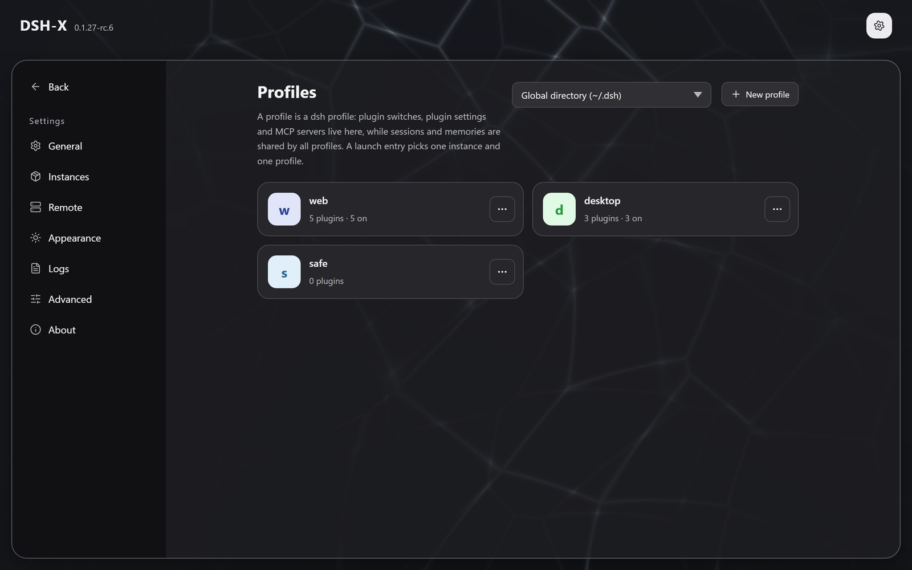
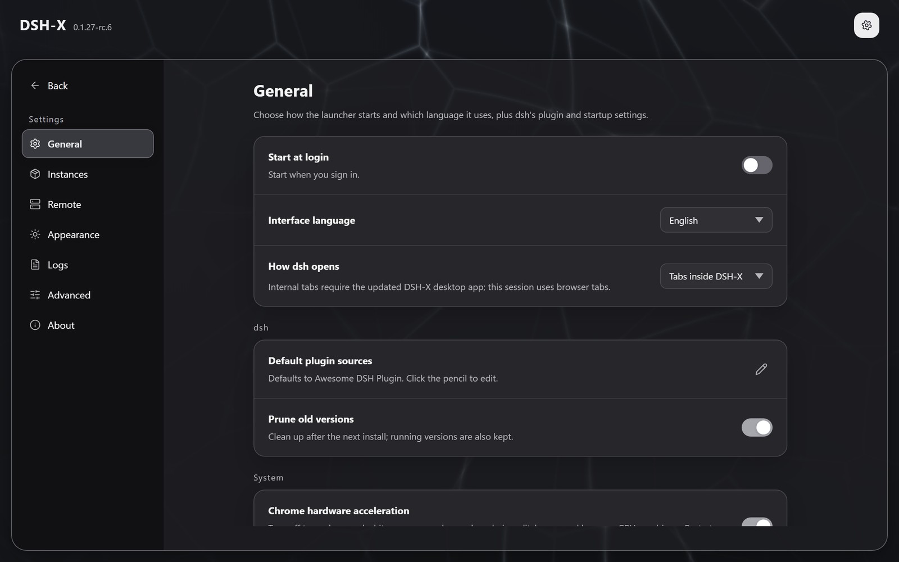
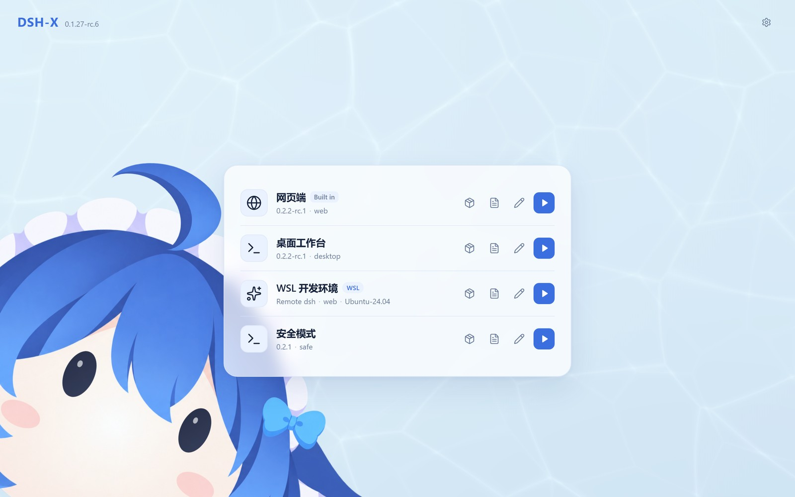
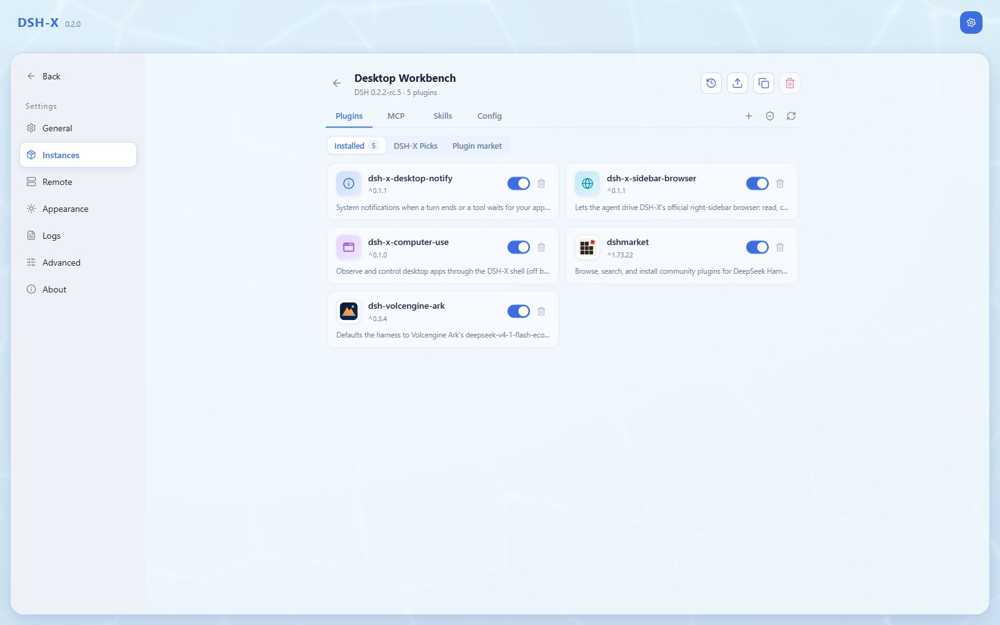

<p align="center">
  
</p>

<p align="center">
  A desktop launcher for <a href="https://github.com/deepseek-ai/deepseek-harness">DeepSeek Harness</a> — multi-instance orchestration, environment isolation, online markets, and cross-platform shell.
</p>

<p align="center">
  
  
  
  <a href="https://github.com/yyh-001/DSH-X/releases"></a>
  
  
  
</p>

<p align="center">
  <samp><a href="https://yyh-001.github.io/DSH-X/">Website</a> · <a href="https://github.com/yyh-001/DSH-X/releases/latest">Download</a> · <a href="docs/releases">Changelog</a> · <a href="CONTRIBUTING.en.md">Contributing</a> · <strong>English</strong> · <a href="README.md">中文</a></samp>
</p>

> [!IMPORTANT]
> **DSH-X launches DeepSeek Harness's own upstream Web UI.**
> It only handles version installation, launch orchestration, and extension management without modifying or rewriting DSH's web pages. DSH-X is a community open-source project, not an official DeepSeek product.

---

## Highlights

- **Concurrent Launches & Windows** — Bind each launch entry to its own user home, profile, instance, and port; run multiple instances side by side with internal tabs or drag-to-detach standalone windows.
- **Instances & Three-Tab Markets** — Manage Plugins, MCP servers, and Skills from each instance's **Installed / Curated / Market** tabs with live search, category filters, one-click install, and real plugin icons.
- **Desktop Enhancements & Computer Use** — The shell provides desktop permissions for `dsh-x-computer-use` (enabled by default with first-use per-app authorization, global `Ctrl+Alt+Backspace` kill switch, and audit logs), alongside native notifications and sidebar browser plugins.
- **WSL & SSH Remote Execution** — Run launch entries inside WSL distros or over SSH; `dsh-x-core` deploys automatically on first start and opens pages locally over an SSH tunnel.
- **`.dspack` Packs & Upstream Tracking** — Pin DSH versions and plugin manifests per instance, import/export via files or GitHub `owner/repo`, and follow upstream releases while preserving local deltas.
- **Version Management & Diagnostics** — Install, switch, or prune versions cleanly; inspect Raw Log, Time Breakdown, and Disk Usage tabs, with red badge alerts and repair plans on plugin errors.

---

## Getting Started

Download the installer for your OS from [Releases](https://github.com/yyh-001/DSH-X/releases/latest):

| Platform | Installer | Notes & First Launch |
| --- | --- | --- |
| **Windows** (10+ x64) | `DSH-X-<version>-win-x64.exe` | Install and launch **DSH-X**. Not Authenticode-signed yet; if SmartScreen prompts, verify SHA256 or report false positives to [Microsoft](https://www.microsoft.com/en-us/wdsi/filesubmission). |
| **macOS** (13+) | `DSH-X-<version>-mac-arm64.dmg`<br>`DSH-X-<version>-mac-x64.dmg` | Drag into Applications. Ad-hoc signed and unnotarized; right-click Open or run:<br>`xattr -dr com.apple.quarantine /Applications/DSH-X.app`. Shell auto-update is currently disabled; core updates still come from npm. |
| **Linux** (x64) | `DSH-X-<version>-linux-x64.AppImage`<br>`DSH-X-<version>-linux-x64.deb` | Make AppImage executable and run (pass `--appimage-extract-and-run` without FUSE), or install deb via `sudo apt install ./DSH-X-<version>-linux-x64.deb` (no shell auto-update). Settings live in `~/.config/DSH`. |

> [!NOTE]
> The installer bundles **only the Electron shell**, not the core. On first launch it fetches `dsh-x-core` for your channel from npm with live progress. Core and shell update independently so UI/backend updates avoid re-downloading 100MB+ installers.

<details>
<summary>Verify downloaded SHA256 checksum</summary>

```sh
certutil -hashfile DSH-X-<version>-win-x64.exe SHA256     # Windows
shasum -a 256 DSH-X-<version>-mac-arm64.dmg              # macOS
sha256sum DSH-X-<version>-linux-x64.AppImage             # Linux
```

</details>

---

## Screenshots

<p align="center">
  
</p>

<p align="center">
  
</p>

<details>
<summary>Management Pages · Dark Theme (expand to view)</summary>

<p align="center"></p>
<p align="center"></p>
<p align="center"></p>

</details>

<details>
<summary>Management Pages · Light Theme (expand to view)</summary>

<p align="center"></p>
<p align="center"></p>
<p align="center"></p>
<p align="center"></p>

</details>

---

## Usage Overview

### Isolation Modes

Choose an isolation level when adding a launch entry (user and version directories are prevented from living inside the launcher installation folder):

| Mode | Created In | Scope |
| --- | --- | --- |
| **Plugin isolation (default)** | A new profile in the global `dsh` directory | Shares sessions, memories & skills; plugins and config separate |
| **Session isolation** | Isolated home under `homes/<name>` in data dir | Everything isolated: sessions, memories, skills & plugins |
| **Custom** | Custom user directory, profile & port | Pick local paths, WSL/SSH targets, or toggle `DSH_HOME` env var |

### Key Workflows

- **Instances & Built-in Recipes**: Manage plugins per instance using the [DSH-PackForge](https://github.com/DSH-PackForge/DSH-PackForge) `.dspack` v5 format; includes built-in [Recommended](src/packs/dsh-x-recommended/manifest.json) and [Desktop Workbench](src/packs/dsh-x-workbench/README.md) recipes (`node scripts/make-pack.mjs` builds `.dspack` archives).
- **Desktop Enhancement Plugins**: Install [Native Notifications (`dsh-x-desktop-notify`)](https://www.npmjs.com/package/dsh-x-desktop-notify), [Sidebar Browser (`dsh-x-sidebar-browser`)](https://www.npmjs.com/package/dsh-x-sidebar-browser), and Computer Use (`dsh-x-computer-use`) via npm from the Curated tab or Settings.
- **Opening Modes & LAN Access**: Switch between internal tabs, standalone windows, or system browser in Settings; the manager defaults to port `3780` and supports LAN binding under Settings → Advanced.
- **Backups & Rollback**: Automatic config-layer snapshots are saved before every launch so you can roll back and reinstall dependencies in one click.

---

## Wallpaper

Companion Wallpaper Engine project — [DSH-X · 大肥鱼桌面终端](https://steamcommunity.com/sharedfiles/filedetails/?id=3814706575): brand intro, mascot animation, clock, and audio spectrum with automatic light/dark palette switching. Sources live in [`wallpaper/`](wallpaper/); run `node scripts/export-wallpaper.mjs` to export.

<details>
<summary>Preview wallpaper</summary>

<p align="center">
  
</p>

</details>

---

## Development & Packaging

Requires **Node.js 22.18+**. The backend and web UI have **zero third-party runtime dependencies**; install dev dependencies (`npm install`) before running the Electron shell or building installers.

| Command | Purpose |
| --- | --- |
| `npm start` | Launch manager server and UI |
| `npm test` | Run offline test suite (`node --test`) |
| `npm run electron` | Run Electron desktop shell from source |
| `npm run dist` | Build `electron-builder` installer for current OS |

See [CONTRIBUTING.en.md](CONTRIBUTING.en.md) for development, commit, and release conventions; verify release manifests with `node scripts/release-manifest.mjs verify` (keep `release/release-key.pem` backed up locally).

---

## Community & Related Projects

- **QQ Groups**: Main [993579665](https://qm.qq.com/q/7AD2g70HqS) · Plugins #2 [Join](https://qm.qq.com/q/hCjdOJOjSw)
- **Changelog & Security**: [Release Notes](docs/releases) · [Security Policy](SECURITY.md)
- **Ecosystem**: [deepseek-harness](https://github.com/deepseek-ai/deepseek-harness) (upstream agent platform) · [DSH-PackForge](https://github.com/DSH-PackForge/DSH-PackForge) (`.dspack` tooling) · [deepseek-harness-desktop](https://github.com/dsh-tauri/deepseek-harness-desktop) (Tauri desktop app)

> [!NOTE]
> Upstream dsh and its plugin ecosystem iterate rapidly; check plugin compatibility before upgrading, and run dsh only in trusted environments since it can execute local code.

<p align="center">
  <a href="LICENSE">MIT License</a> © 2026 yyh
</p>
