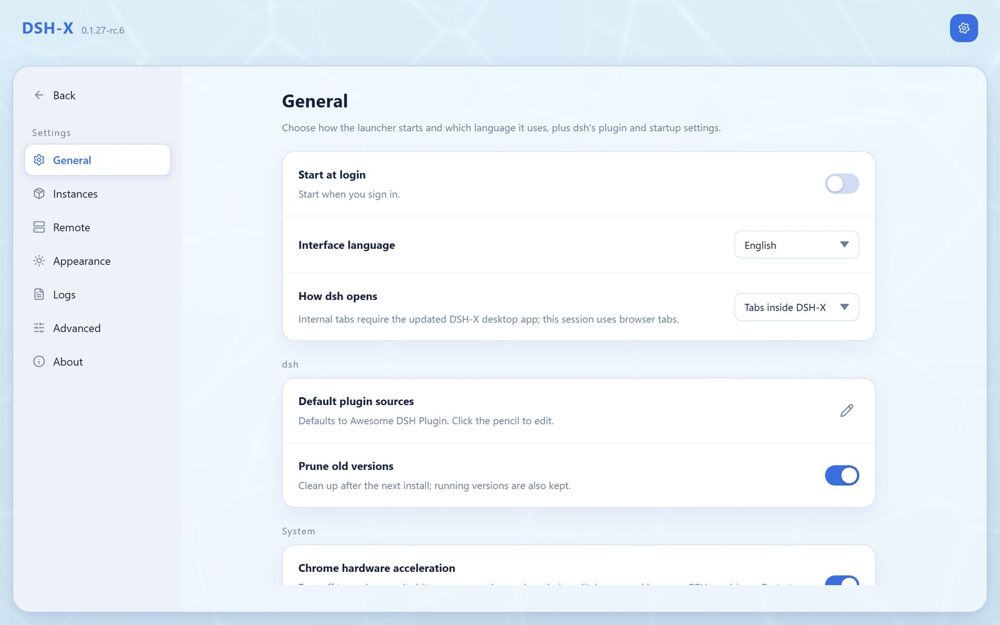
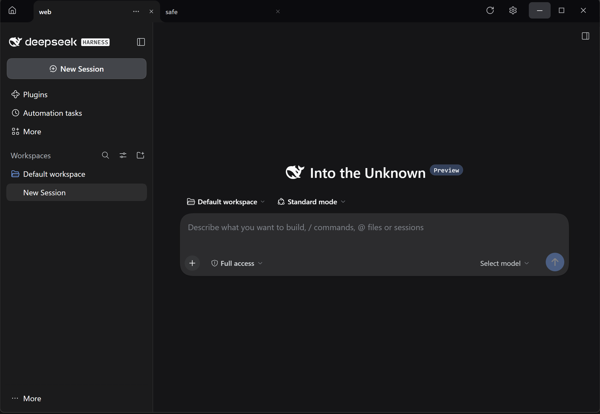

<p align="center">
  <a href="README.md">简体中文</a> · <b>English</b>
</p>

<p align="center">
  <picture>
    <source media="(prefers-color-scheme: dark)" srcset="docs/hero-en-dark.png" />
    
  </picture>
</p>

<p align="center">
  <a href="https://github.com/deepseek-ai/deepseek-harness">DeepSeek Harness</a> launcher: install and switch versions, isolate plugin and session environments, and control your instances from mobile.<br />
  <sub>DSH-X launches DeepSeek Harness's official web UI untouched. It is a community open-source project, not an official DeepSeek product.</sub>
</p>

<p align="center">
  <a href="https://github.com/yyh-001/DSH-X/releases/latest"></a>
  <a href="https://github.com/yyh-001/DSH-X/releases"></a>
  <a href="https://github.com/yyh-001/DSH-X/stargazers"></a>
  <a href="LICENSE"></a>
  <a href="https://qm.qq.com/q/7AD2g70HqS"></a>
</p>

<p align="center">
  <a href="https://github.com/yyh-001/DSH-X/releases/latest"></a>&emsp;<a href="https://yyh-001.github.io/DSH-X/"></a>
</p>

<p align="center">
  <samp><a href="#installation">Installation</a> · <a href="#screenshots">Screenshots</a> · <a href="docs/releases">Changelog</a> · <a href="CONTRIBUTING.en.md">Contributing</a></samp>
</p>

## Highlights

- **Multi-instance isolation** — Pair DSH versions, user directories, plugin profiles, and pinned ports per launch item; run concurrently with standalone windows and reload-free cross-window tab drag-and-drop.
- **Built-in Plugin, MCP & Skills markets** — Installed / Curated / Market views with automatic mirror fallback, one-click installs, per-profile toggles, and `.dspack` instance import/export.
- **Local, WSL, SSH & Mobile access** — Manage WSL and SSH remote hosts seamlessly; built-in Mobile Access with QR pairing and Cloudflare Tunnel lets you inspect logs and start/stop/open desktop instances from a mobile PWA.
- **Desktop enhancements** — Built-in native system notifications, Browser Use (sidebar browser), and Computer Use.
- **Startup diagnostics & safe recovery** — Raw logs, startup time profiling, and disk usage breakdown; automatic config snapshots before launch with one-click recovery and rollback.

## Screenshots

<p align="center">
  <picture>
    <source media="(prefers-color-scheme: dark)" srcset="docs/screenshots/screenshot-home-dark-en.jpg" />
    
  </picture>
</p>

<p align="center">
  <picture>
    <source media="(prefers-color-scheme: dark)" srcset="docs/screenshots/screenshot-plugins-dark-en.jpg" />
    
  </picture>
</p>

<p align="center">
  <picture>
    <source media="(prefers-color-scheme: dark)" srcset="docs/screenshots/screenshot-mobile-dark-en.jpg" />
    
  </picture>
</p>

<details>
<summary>More screenshots (Remote & Mobile Access, Profiles, Settings, Multi-Tab View)</summary>

<p align="center">
  <picture>
    <source media="(prefers-color-scheme: dark)" srcset="docs/screenshots/screenshot-remote-dark-en.jpg" />
    
  </picture>
</p>
<p align="center">
  <picture>
    <source media="(prefers-color-scheme: dark)" srcset="docs/screenshots/screenshot-profiles-dark-en.jpg" />
    
  </picture>
</p>
<p align="center">
  <picture>
    <source media="(prefers-color-scheme: dark)" srcset="docs/screenshots/screenshot-settings-dark-en.jpg" />
    
  </picture>
</p>
<p align="center">
  
</p>

</details>

## Installation

Download the installer for your OS from [Releases](https://github.com/yyh-001/DSH-X/releases/latest) or the [website](https://yyh-001.github.io/DSH-X/):

| Platform | Package | Install |
| --- | --- | --- |
| **Windows** (10+ x64) | `DSH-X-<version>-win-x64.exe` | Run the installer and launch **DSH-X** |
| **macOS** (13+, Apple Silicon / Intel) | `DSH-X-<version>-mac-arm64.dmg` / `x64.dmg` | Open the DMG and drag into Applications |
| **Linux** (x64 / arm64) | `DSH-X-<version>-linux-<arch>.AppImage` / `.deb` | Make the AppImage executable and run, or `sudo apt install ./DSH-X-*.deb` |

With **Node.js 22.18+** or on a headless server / container, you can also run the web manager directly via npm without installing the desktop shell:

```sh
npx dsh-x-core                 # run directly (or npm i -g dsh-x-core && dsh-x-core)
DSH_NO_OPEN=1 dsh-x-core       # server / container mode: start without opening a browser (set PORT as needed)
```

<details>
<summary>First launch, OS security prompts, and SHA256 verification</summary>

- **Split shell & core updates**: Installers contain only the Electron shell and fetch `dsh-x-core` from npm on first launch. Subsequent UI and backend updates apply automatically without re-downloading full installers. macOS and Linux `.deb` builds prompt on the home page when a new shell installer is available.
- **Windows SmartScreen**: Not Authenticode-signed yet; verify SHA256 before proceeding or report false positives to [Microsoft](https://www.microsoft.com/en-us/wdsi/filesubmission).
- **macOS Gatekeeper**: Ad-hoc signed and unnotarized; right-click Open or run `xattr -dr com.apple.quarantine /Applications/DSH-X.app`.
- **Linux without FUSE**: Run AppImage with `--appimage-extract-and-run`. Config is stored in `~/.config/DSH`.
- **Verify SHA256**:

```sh
certutil -hashfile DSH-X-<version>-win-x64.exe SHA256     # Windows
shasum -a 256 DSH-X-<version>-mac-arm64.dmg              # macOS
sha256sum DSH-X-<version>-linux-x64.AppImage             # Linux
```

</details>

## Isolation Modes

Pick the isolation level when creating a launch entry (user and version directories are prevented from being placed inside the launcher install folder):

| Mode | Created In | Scope |
| --- | --- | --- |
| **Plugin isolation (default)** | New profile in the global `dsh` directory | Shares sessions, memories & skills; plugins and config isolated |
| **Session isolation** | Isolated home under `homes/<name>` in data dir | Everything isolated: sessions, memories, skills & plugins |
| **Custom** | Custom user directory, profile & port | Pick local folders, WSL / SSH remotes, or set `DSH_HOME` env var |

## Development

Requires **Node.js 22.18+**. The backend and web UI have **zero third-party runtime dependencies**; run `npm install` before launching the Electron shell or packaging installers.

| Command | Purpose |
| --- | --- |
| `npm start` | Launch manager server and UI |
| `npm test` | Run offline test suite (`node --test`) |
| `npm run electron` | Run Electron desktop shell from source |
| `npm run dist` | Build installer for the current platform |

See [CONTRIBUTING.en.md](CONTRIBUTING.en.md) for conventions and repo layout. Built-in [Recommended](src/packs/dsh-x-recommended/manifest.json) and [Desktop Workbench](src/packs/dsh-x-workbench/README.md) `.dspack` recipes can be packaged via `node scripts/make-pack.mjs`.

## Community & Ecosystem

- **QQ Groups**: Main [993579665](https://qm.qq.com/q/7AD2g70HqS) · Plugins #2 [Join](https://qm.qq.com/q/hCjdOJOjSw)
- **Changelog & Security**: [Release Notes](docs/releases) · [Security Policy](SECURITY.md)
- **Related Projects**: [deepseek-harness](https://github.com/deepseek-ai/deepseek-harness) (upstream platform) · [DSH-PackForge](https://github.com/DSH-PackForge/DSH-PackForge) (`.dspack` format) · [deepseek-harness-desktop](https://github.com/dsh-tauri/deepseek-harness-desktop) (Tauri desktop app)

<details>
<summary>Companion Wallpaper Engine Project</summary>

Steam Workshop: [DSH-X · 大肥鱼桌面终端](https://steamcommunity.com/sharedfiles/filedetails/?id=3814706575) — interactive mascot, clock, and audio spectrum with automatic light/dark switching. Sources live in [`wallpaper/`](wallpaper/); export with `node scripts/export-wallpaper.mjs`.

<p align="center">
  
</p>

</details>

> [!NOTE]
> Upstream `dsh` and its plugin ecosystem iterate rapidly; check plugin compatibility before upgrading, and run `dsh` only in trusted environments since it can execute local code.

<p align="center">
  <a href="LICENSE">MIT License</a> © 2026 yyh
</p>
