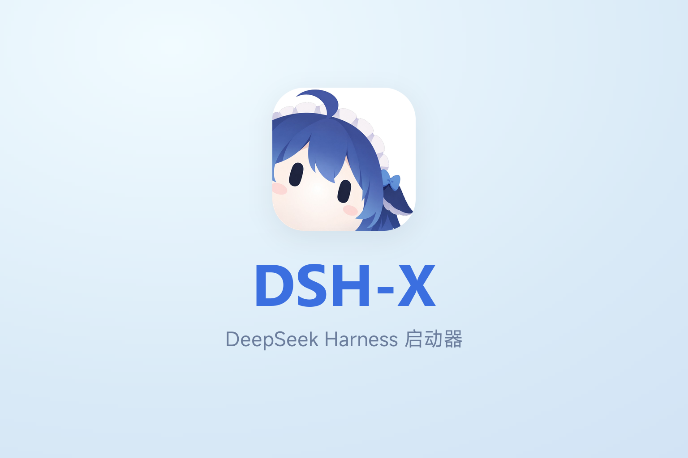
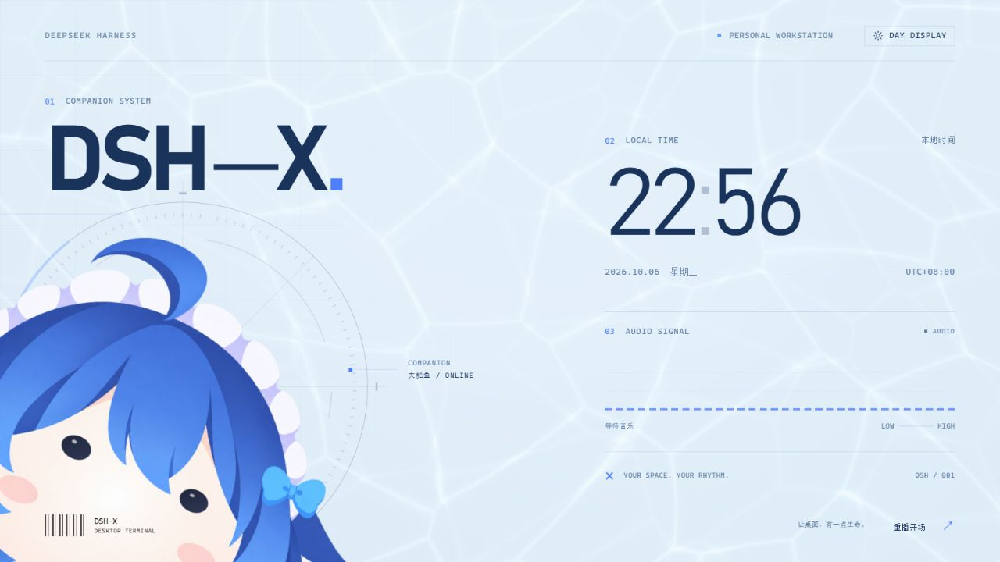

<p align="center">
  
</p>

<p align="center">
  <a href="https://github.com/deepseek-ai/deepseek-harness">DeepSeek Harness</a> 的第三方桌面启动器 ——<br />
  启动项与多实例，版本、插件、整合包、MCP 和技能管理。
</p>

<p align="center">
  
  
  
</p>

<p align="center">
  <a href="https://github.com/yyh-001/DSH-X/releases">
    
  </a>
  <a href="https://www.npmjs.com/package/@yyh001/dsh-x">
    
  </a>
  
  <br>
  
  
  
</p>

<p align="center">
  <samp><a href="https://yyh-001.github.io/DSH-X/">主页</a> · <a href="https://github.com/yyh-001/DSH-X/releases/latest">下载</a> · <a href="docs/releases">更新日志</a> · <a href="CONTRIBUTING.md">参与贡献</a> · <a href="README.en.md">English</a> · <strong>中文</strong></samp>
</p>

> [!IMPORTANT]
> **DSH-X 启动的是 DeepSeek Harness 官方原版 Web 页面。**  
> 它只负责版本安装、启动和插件管理，不修改也不重做 DSH 的网页界面。DSH-X 本身是社区开源项目，并非 DeepSeek 官方产品。

## 功能

- 🚀 **启动项与多实例** — 按项选择用户目录、profile、版本和端口；支持并行启动，运行中也可添加启动项。
- 📦 **版本管理** — 独立管理已安装版本，支持检测新版本、手动安装、卸载和为启动项指定版本。
- 🧩 **插件与整合包** — 按环境安装、开关和更新插件，可配置官方自定义插件市场的默认索引源；整合包市场支持瀑布流浏览、搜索和排序，也能导入、导出整合包。
- 🖥️ **桌面增强** — 新建启动项时勾一下，把原生通知、右键菜单、侧栏浏览器三个首方插件装进这个环境；编辑启动项时还能补装，装完可在插件页单独开关和更新。
- 🛠️ **MCP 与技能** — 配置 MCP 服务器，导入、管理和开关技能。
- 🪟 **多种打开方式** — DSH-X 内部标签页、系统浏览器标签页、浏览器独立窗口或桌面窗口。
- 🎨 **外观** — 浅色 / 深色主题、透明度、开场与启动项动效，以及独立的背景和大肥鱼开关。
- 🔄 **更新与恢复** — 自更新、故障恢复、可设置保留数量的旧版本清理；启动项当前与上一次使用的版本额外保留。
- ⚙️ **桌面系统开关** — 硬件加速、自动下载更新（安装手动确认）、任务通知与提示音、关窗口隐藏到托盘、防休眠。
- 💻 **Windows / macOS / Linux** — 三个平台的安装包，支持托盘 / 菜单栏常驻和开机自启，自带 npm / pnpm 包装。

## 快速开始

从 [Releases](https://github.com/yyh-001/DSH-X/releases/latest) 下载对应平台的安装包：

| 平台 | 系统要求 | 安装包 |
| --- | --- | --- |
| Windows | Windows 10 及以上，x64 | `DSH-Setup-<版本>.exe`（NSIS） |
| macOS | macOS 13 及以上 | `DSH-X-<版本>-arm64.dmg`（Apple Silicon）/ `DSH-X-<版本>-x64.dmg`（Intel） |
| Linux | x64；AppImage 依赖 FUSE | `DSH-X-<版本>-x86_64.AppImage` / `DSH-X-<版本>-amd64.deb` |

### Windows

下载 `DSH-Setup-<版本>.exe` 安装，从桌面打开 **DSH-X**。安装包未做 Authenticode 签名，SmartScreen 可能提示「未知发布者」，见[签名与杀软误报](#签名与杀软误报)。

### macOS

打开 dmg，把 **DSH-X** 拖进「应用程序」。目前使用 ad-hoc 签名、未做公证，首次打开可能需要在系统安全提示中手动允许；如果提示「已损坏」或「无法验证开发者」，右键打开，或执行：

```sh
xattr -dr com.apple.quarantine /Applications/DSH-X.app
```

mac 的外壳自更新暂不提供，核心仍走 npm 更新。

### Linux

下载 `DSH-X-<版本>-x86_64.AppImage`，`chmod +x` 后直接运行；没有 FUSE 时用 `./DSH-X-<版本>-x86_64.AppImage --appimage-extract-and-run`。

Debian / Ubuntu 也可以装 deb（装到 `/opt/DSH-X`、带菜单项、`apt remove dsh-x` 卸干净），但 **deb 版没有外壳自更新**，换版本要去发布页重新下载：

```sh
sudo apt install ./DSH-X-<版本>-amd64.deb
```

配置在 `~/.config/DSH`，核心缓存在 `~/.cache/dsh-x`；两种包的核心更新都走 npm。

### 校验下载

Release 页面每个文件旁边有 sha256，本地对一下即可：

```sh
certutil -hashfile DSH-Setup-<版本>.exe SHA256        # Windows
shasum -a 256 DSH-X-<版本>-arm64.dmg                  # macOS
sha256sum DSH-X-<版本>-x86_64.AppImage                # Linux
```

## 使用

- 在主页添加或编辑启动项，选择环境与版本后启动；编辑启动项时可打开 **版本管理**，手动安装或卸载版本。
- 设置 → 常规 → **打开 dsh 的方式**，可选 DSH-X 内部标签页、浏览器或独立窗口。内部标签页需要使用安装后的桌面端。
- 管理页默认端口为 `3780`，被占用时会顺延。
- 手机或其他电脑访问 dsh：设置 → 高级设置 → **Web 绑定**选「局域网」，下次启动生效。

## 界面预览

**多启动项 · 深色主题**

<p align="center">
  
</p>

<details>
<summary>管理页面 · 深色主题（展开查看）</summary>

**环境列表**

<p align="center">
  
</p>

**插件管理**

<p align="center">
  
</p>

**整合包市场**

<p align="center">
  
</p>

**常规设置**

<p align="center">
  
</p>

</details>

<details>
<summary>管理页面 · 浅色主题（展开查看）</summary>

**启动器主页**

<p align="center">
  
</p>

**环境列表**

<p align="center">
  
</p>

**插件管理**

<p align="center">
  
</p>

**整合包市场**

<p align="center">
  
</p>

**常规设置**

<p align="center">
  
</p>

</details>

**多标签页 · 深色主题**

<p align="center">
  
</p>

## 整合包

整合包把一组插件和配置装进选定的环境（profile）。插件页按环境展示，装过包的环境会标明来源，插件仍可单独开关。使用 [DSH-PackForge](https://github.com/DSH-PackForge/DSH-PackForge) `.dspack` 格式（manifest v5，兼容旧版本）。

- **导入** — 社区市场、本地文件、直链或 GitHub `owner/repo`。默认安装到当前选中的环境，确认前可切换目标。
- **安装** — 先查看插件和文件变更，再确认安装；覆盖前备份，失败自动回滚。
- **导出** — 把当前环境的依赖、补丁层与配置打成 `.dspack`，不含 `node_modules` 与凭据。

仓库中有两套配方：

- [推荐整合包](src/packs/dsh-x-recommended/manifest.json) — 配置管理、记忆、同步和大肥鱼装饰插件，均从 npm 安装（同步由可选插件 `dsh-x-sync` 提供）。
- [桌面工作台](src/packs/dsh-x-workbench/README.md) — 把 dsh-tauri 桌面版的侧栏工作台、工作树、定时任务、归档和通知在纯 dsh 生态里凑齐，并带上 ZCode 的 `agent-browser` 与 `electron` 技能。

运行 `node scripts/make-pack.mjs` 可生成 `.dspack`，再作为本地文件导入。

## 桌面增强

「添加启动项」里勾上「安装桌面增强」，保存时把三个首方插件装进这个启动项对应的 profile（从 npm 装，不随安装包发；装完在插件页单独开关和更新）。编辑启动项时还能看到装了几个、补装缺的；取消勾选不会卸载。

- [原生通知](https://www.npmjs.com/package/dsh-x-desktop-notify) — 一轮结束、等你确认时发系统通知，并把桌面能力借给其它插件
- [右键菜单](https://www.npmjs.com/package/dsh-x-context-menu) — 会话、工作区、选中文字、链接和输入框的右键菜单，纯网页插件、不依赖桌面外壳
- [侧栏浏览器](https://www.npmjs.com/package/dsh-x-sidebar-browser) — 操作 dsh 官方右栏 Browser：快照、点击、输入、截图

## 动态壁纸

配套的 Wallpaper Engine 壁纸[《DSH-X · 大肥鱼桌面终端》](https://steamcommunity.com/sharedfiles/filedetails/?id=3814706575)：DSH-X 品牌开场、大肥鱼、本机时间与音乐频谱，按时间自动切换深浅配色。源码在 [`wallpaper/`](wallpaper/)，`node scripts/export-wallpaper.mjs` 导出 Wallpaper Engine 工程。

<p align="center">
  
</p>

## 签名与杀软误报

发布清单的签名用于校验文件完整性，与 Windows 发布者签名不同。目前 `DSH-Setup-<版本>.exe` 和给 0.1.18 旧更新器用的兼容桥 `DSH-Setup.exe` 都尚未做 Authenticode 签名，可能出现 SmartScreen「未知发布者」提示。杀软误报可向[微软](https://www.microsoft.com/en-us/wdsi/filesubmission)或对应杀软厂商提交安装包申诉。

## 说明

> [!WARNING]
> **上游仍在快速迭代** — dsh 内核与插件生态更新频繁，可能存在破坏性变更；升级前请确认插件兼容性。

> [!NOTE]
> **安全提示** — dsh 具备本地代码执行能力，DSH-X 只负责安装与启动。请仅在可信环境中使用。

## 开发

本机需要 Node.js 22.18+。启动器本身没有第三方依赖：`npm start` 启动管理页，只起服务用 `npm run server`，测试用 `npm test`。外壳是 Electron，`npm run electron` 或打安装包前先 `npm install`。

开发、提交与发版约定见 [CONTRIBUTING.md](CONTRIBUTING.md)。

### 打包

```sh
npm install
npm run dist
```

Windows 产出 `release/eb/DSH-Setup-<版本>.exe`（NSIS）和给 0.1.18 旧更新器用的兼容桥 `release/eb/DSH-Setup.exe`；macOS 产出 `release/eb/DSH-X-<版本>-<arch>.dmg`；Linux 产出 `release/eb/DSH-X-<版本>-x86_64.AppImage`。安装包由 electron-builder 生成，不再需要 Rust / Inno Setup。

发版前检查版本与产物（发布清单与 SBOM 只在本机自查，不上传 Release）：

```sh
node scripts/release-manifest.mjs check-tag v0.1.22
node scripts/release-manifest.mjs verify
```

GitHub Actions 的 `build` 工作流构建 Windows / macOS / Linux 三个平台的安装包，并在 tag 上发布 npm 核心包与 CLI。macOS 目前只出 dmg（临时签名，外壳自更新暂不提供）；Linux 用 AppImage + `latest-linux.yml`。

发布清单的私钥在 `release/release-key.pem`（已被忽略、不进仓库，**务必备份**）。

## 参与

- 安全问题见 [SECURITY.md](SECURITY.md)，别开公开 issue。
- 每个版本改了什么，见 [docs/releases](docs/releases)。
- 交流 / 反馈：**QQ 群 [993579665](https://qm.qq.com/q/7AD2g70HqS)**（[点击加入](https://qm.qq.com/q/7AD2g70HqS)）
- 插件 2 群（DeepSeek Harness）：[点击链接加入群聊](https://qm.qq.com/q/hCjdOJOjSw)

## 相关项目

- [deepseek-harness](https://github.com/deepseek-ai/deepseek-harness) — 上游 dsh agent 平台
- [DSH-PackForge](https://github.com/DSH-PackForge/DSH-PackForge) — 整合包 `.dspack` 格式与配方工具
- [deepseek-harness-desktop](https://github.com/dsh-tauri/deepseek-harness-desktop) — 同生态的 Tauri 桌面版，本仓库的整合包配方参考了它的插件集合

## 许可

[MIT](LICENSE) © 2026 yyh
