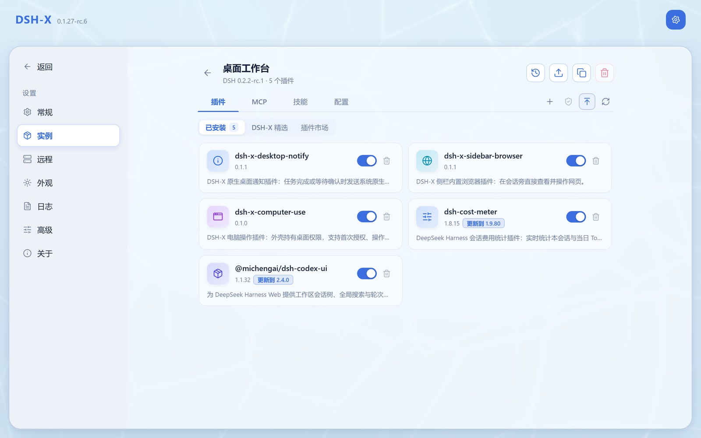
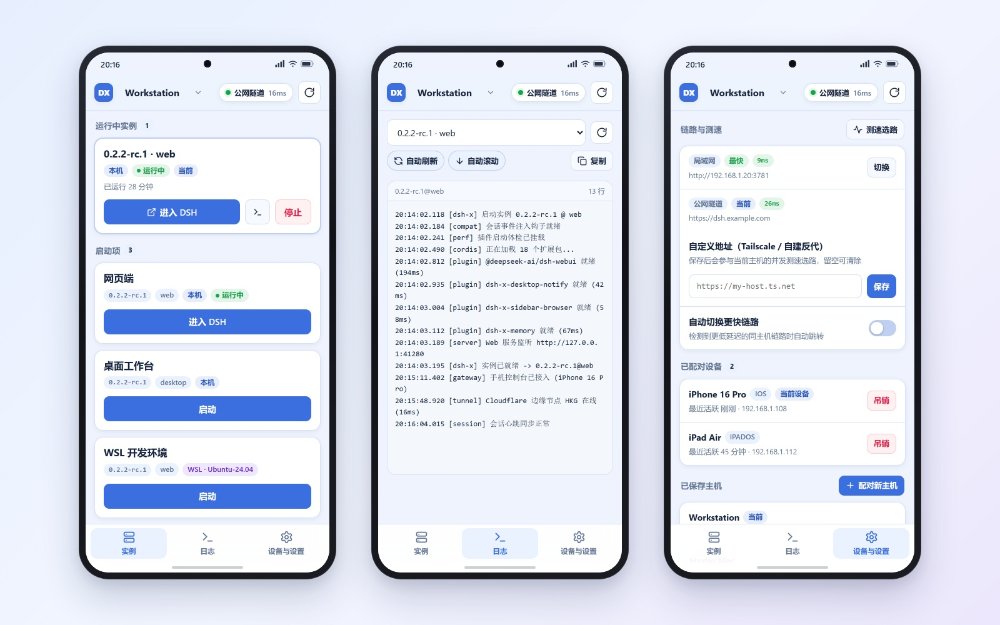
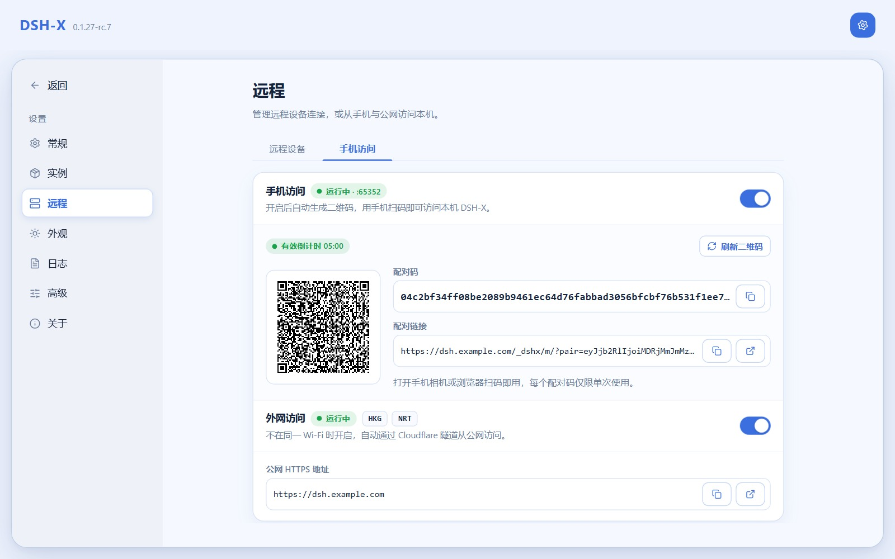
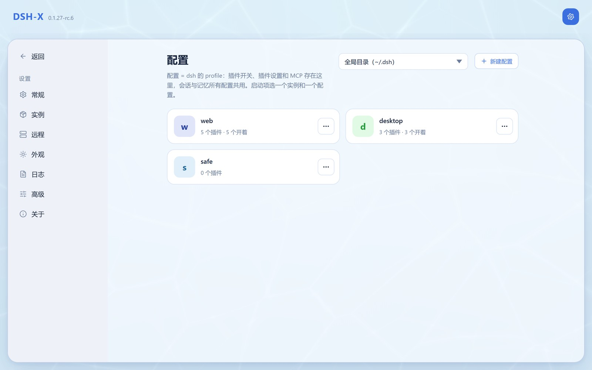
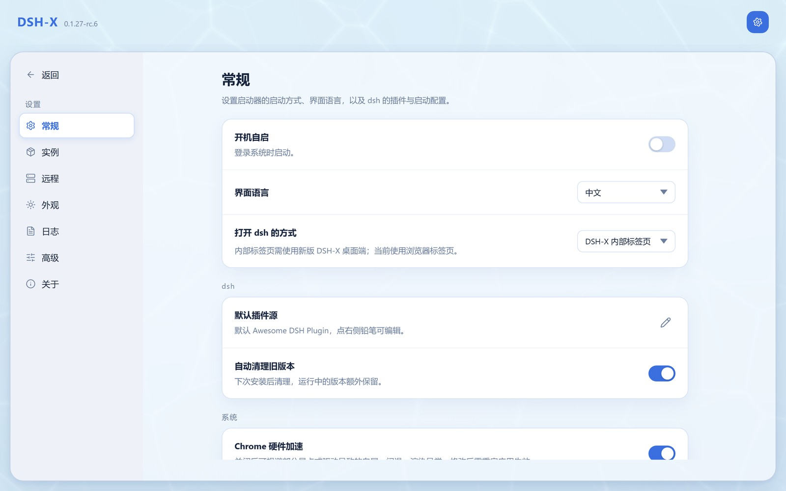

<p align="center">
  <b>简体中文</b> · <a href="README.en.md">English</a>
</p>

<p align="center">
  <picture>
    <source media="(prefers-color-scheme: dark)" srcset="docs/hero-zh-dark.png" />
    
  </picture>
</p>

<p align="center">
  <a href="https://github.com/deepseek-ai/deepseek-harness">DeepSeek Harness</a> 启动器：一键安装切换版本、隔离插件与会话环境，并在手机端随时遥控。<br />
  <sub>DSH-X 启动的是 DeepSeek Harness 官方原版 Web 页面，不修改原版界面；本项目为社区开源，非 DeepSeek 官方产品。</sub>
</p>

<p align="center">
  <a href="https://github.com/yyh-001/DSH-X/releases/latest"></a>
  <a href="https://github.com/yyh-001/DSH-X/releases"></a>
  <a href="https://github.com/yyh-001/DSH-X/stargazers"></a>
  <a href="LICENSE"></a>
  <a href="https://qm.qq.com/q/7AD2g70HqS"></a>
</p>

<p align="center">
  <a href="https://github.com/yyh-001/DSH-X/releases/latest"></a>&emsp;<a href="https://yyh-001.github.io/DSH-X/"></a>
</p>

<p align="center">
  <samp><a href="#安装">快速安装</a> · <a href="#界面预览">界面预览</a> · <a href="docs/releases">更新日志</a> · <a href="CONTRIBUTING.md">参与贡献</a></samp>
</p>

## 核心特性

- **多实例与环境隔离** — 自由组合 DSH 版本、用户目录、插件配置与固定端口，支持并行运行、独立窗口与标签无刷新跨窗拖放。
- **插件、MCP 与技能一站式市场** — 内置「已安装 / 精选 / 市场」三签视图与多镜像回退，支持一键安装、按配置开关及 `.dspack` 实例镜像导入导出。
- **全端协同：本机 · WSL · SSH · 手机** — 支持管理 WSL 与 SSH 远端主机；内置「手机访问」与 Cloudflare 外网穿透，扫码即可在手机 PWA 查看日志、启停并进入桌面实例。
- **桌面增强** — 内置原生系统通知、Browser Use（侧栏浏览器）与 Computer Use（电脑操作）。
- **启动诊断与安全回退** — 日志内置原始输出、耗时构成与空间占用分析；每次启动自动备份配置层，插件异常时一键安全恢复或回退。

## 界面预览

<p align="center">
  <picture>
    <source media="(prefers-color-scheme: dark)" srcset="docs/screenshots/screenshot-launches.png" />
    
  </picture>
</p>

<p align="center">
  <picture>
    <source media="(prefers-color-scheme: dark)" srcset="docs/screenshots/screenshot-plugins-dark.jpg" />
    
  </picture>
</p>

<p align="center">
  <picture>
    <source media="(prefers-color-scheme: dark)" srcset="docs/screenshots/screenshot-mobile-dark.jpg" />
    
  </picture>
</p>

<details>
<summary>更多界面截图（远程与手机访问、配置管理、设置、多标签页）</summary>

<p align="center">
  <picture>
    <source media="(prefers-color-scheme: dark)" srcset="docs/screenshots/screenshot-remote-dark.jpg" />
    
  </picture>
</p>
<p align="center">
  <picture>
    <source media="(prefers-color-scheme: dark)" srcset="docs/screenshots/screenshot-profiles-dark.jpg" />
    
  </picture>
</p>
<p align="center">
  <picture>
    <source media="(prefers-color-scheme: dark)" srcset="docs/screenshots/screenshot-settings-dark.jpg" />
    
  </picture>
</p>
<p align="center">
  
</p>

</details>

## 安装

从 [Releases](https://github.com/yyh-001/DSH-X/releases/latest) 或[主页](https://yyh-001.github.io/DSH-X/)下载对应平台安装包：

| 平台 | 下载文件 | 安装方式 |
| --- | --- | --- |
| **Windows** (10+ x64) | `DSH-X-<版本>-win-x64.exe` | 运行安装程序，安装后从桌面启动 **DSH-X** |
| **macOS** (13+, Apple Silicon / Intel) | `DSH-X-<版本>-mac-arm64.dmg` / `x64.dmg` | 打开 DMG，拖入「应用程序」文件夹 |
| **Linux** (x64 / arm64) | `DSH-X-<版本>-linux-<架构>.AppImage` / `.deb` | 赋予 AppImage 执行权限直接运行，或 `sudo apt install ./DSH-X-*.deb` |

已有 **Node.js 22.18+** 或在无桌面服务器 / 容器中运行，也可跳过安装包直接通过 npm 启动 Web 管理页：

```sh
npx dsh-x-core                 # 直接运行（或 npm i -g dsh-x-core && dsh-x-core）
DSH_NO_OPEN=1 dsh-x-core       # 服务器 / 容器模式：只起服务不打开浏览器（可用 PORT 指定端口）
```

<details>
<summary>首次启动说明、系统安全拦截处理与 SHA256 校验</summary>

- **外壳与核心分离更新**：安装包仅含 Electron 外壳，首次启动会联网从 npm 拉取 `dsh-x-core`；后续界面与后端更新直接走在线核心更新，无需重新下载完整安装包。macOS 与 Linux `.deb` 暂不提供外壳静默自更新，有新外壳时首页会提示下载。
- **Windows SmartScreen**：暂未购买 Authenticode 证书，如提示未知发布者可核对 SHA256 后放行，或向[微软](https://www.microsoft.com/en-us/wdsi/filesubmission)反馈误报。
- **macOS 门禁提示**：安装包采用 ad-hoc 签名未公证，如提示已损坏或无法打开，请右键打开或执行：`xattr -dr com.apple.quarantine /Applications/DSH-X.app`。
- **Linux 无 FUSE 环境**：AppImage 可加 `--appimage-extract-and-run` 参数运行；数据默认保存在 `~/.config/DSH`。
- **校验 SHA256**：

```sh
certutil -hashfile DSH-X-<版本>-win-x64.exe SHA256     # Windows
shasum -a 256 DSH-X-<版本>-mac-arm64.dmg              # macOS
sha256sum DSH-X-<版本>-linux-x64.AppImage             # Linux
```

</details>

## 隔离方式

新建启动项时可按需选择隔离粒度（同时防止将用户目录或版本目录误设在启动器安装目录内）：

| 隔离方式 | 存储位置 | 数据与扩展范围 |
| --- | --- | --- |
| **插件隔离（默认）** | 全局 `dsh` 目录下的独立配置 | 共享会话、记忆与技能；插件与配置独立 |
| **会话隔离** | 数据目录 `homes/<名称>` 独立目录 | 会话、记忆、技能、插件全部隔离 |
| **自定义** | 自定义目录、配置与端口 | 支持导入本地目录、WSL / SSH 远端或一键设为 `DSH_HOME` |

## 开发与构建

需要 **Node.js 22.18+**。服务端与管理页**零第三方运行时依赖**；运行 Electron 外壳或打包前请先执行 `npm install`。

| 命令 | 说明 |
| --- | --- |
| `npm start` | 启动管理页服务（开发调试） |
| `npm test` | 运行全量离线测试套件（`node --test`） |
| `npm run electron` | 从源码启动 Electron 桌面外壳 |
| `npm run dist` | 构建当前平台安装包 |

提交规范与目录结构见 [CONTRIBUTING.md](CONTRIBUTING.md)；内置 [推荐实例](src/packs/dsh-x-recommended/manifest.json) 与 [桌面工作台](src/packs/dsh-x-workbench/README.md) 配方，执行 `node scripts/make-pack.mjs` 可本地打包 `.dspack`。

## 社区与生态

- **交流群**：QQ 群 [993579665](https://qm.qq.com/q/7AD2g70HqS) · 插件 2 群 [加入群聊](https://qm.qq.com/q/hCjdOJOjSw)
- **版本与安全**：[更新日志](docs/releases) · [漏洞反馈（SECURITY.md）](SECURITY.md)
- **相关项目**：[deepseek-harness](https://github.com/deepseek-ai/deepseek-harness)（上游引擎）· [DSH-PackForge](https://github.com/DSH-PackForge/DSH-PackForge)（`.dspack` 整合包规范）· [deepseek-harness-desktop](https://github.com/dsh-tauri/deepseek-harness-desktop)（Tauri 桌面端）

<details>
<summary>配套动态壁纸（Wallpaper Engine）</summary>

创意工坊：[《DSH-X · 大肥鱼桌面终端》](https://steamcommunity.com/sharedfiles/filedetails/?id=3814706575)（含看板娘互动、时间与音频频谱，随时间切换深浅主题；源码位于 [`wallpaper/`](wallpaper/)，执行 `node scripts/export-wallpaper.mjs` 导出）。

<p align="center">
  
</p>

</details>

> [!NOTE]
> 上游 `dsh` 内核与插件生态迭代较快，升级前建议确认插件兼容性；`dsh` 具备本地代码执行能力，请仅在可信环境中使用。

<p align="center">
  <a href="LICENSE">MIT License</a> © 2026 yyh
</p>
