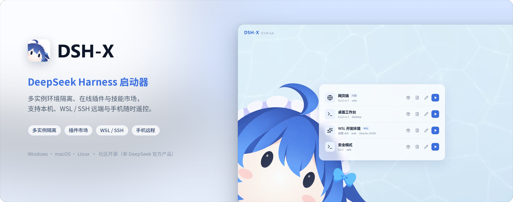
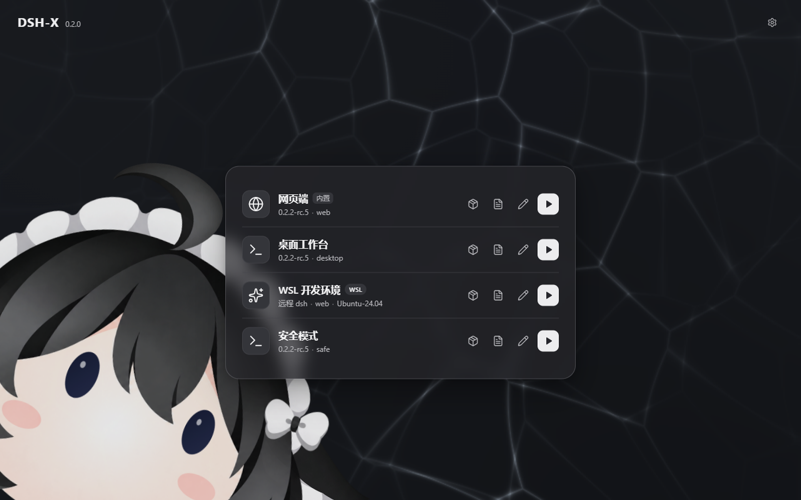
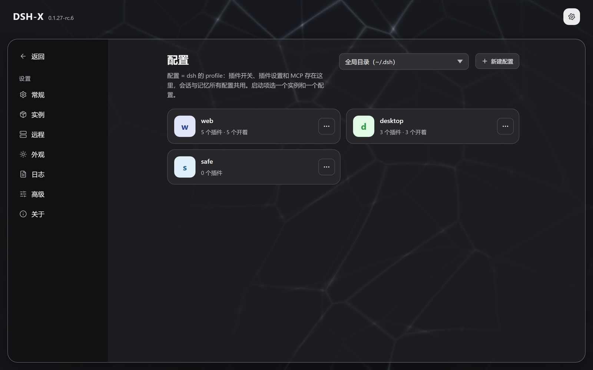
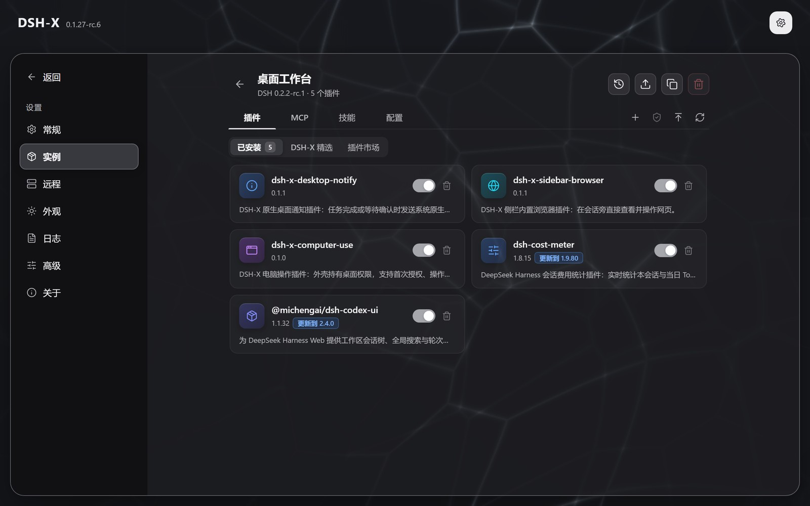
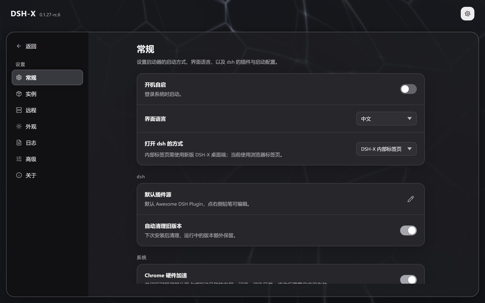
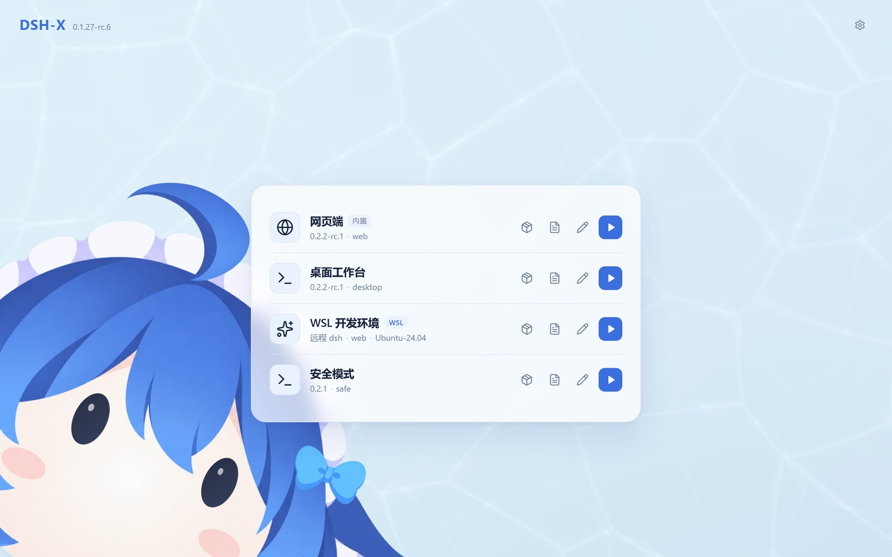
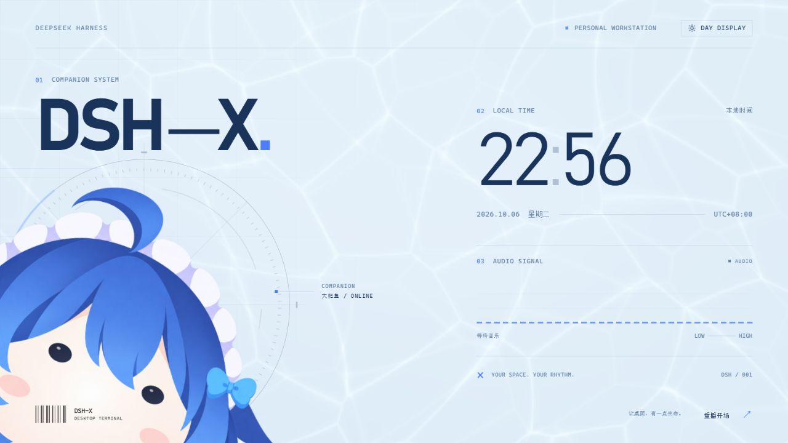

<p align="center">
  
</p>

<p align="center">
  <a href="https://github.com/deepseek-ai/deepseek-harness">DeepSeek Harness</a> 桌面启动器 —— 多实例并行、版本与环境隔离、在线市场与跨平台外壳。
</p>

<p align="center">
  
  
  
  <a href="https://github.com/yyh-001/DSH-X/releases"></a>
  
  
  
</p>

<p align="center">
  <samp><a href="https://yyh-001.github.io/DSH-X/">主页</a> · <a href="https://github.com/yyh-001/DSH-X/releases/latest">下载安装包</a> · <a href="docs/releases">更新日志</a> · <a href="CONTRIBUTING.md">参与贡献</a> · <a href="README.en.md">English</a> · <strong>中文</strong></samp>
</p>

> [!IMPORTANT]
> **DSH-X 启动的是 DeepSeek Harness 官方原版 Web 界面。**
> 它只负责版本安装、启动编排与扩展管理，不修改或重做 DSH 原生页面；本项目为社区开源项目，并非 DeepSeek 官方产品。

---

## 核心特性

- **启动项与多窗并发** — 每个启动项独立绑定用户目录、配置（profile）、实例与端口，支持多实例同时运行、内部标签页与独立窗口跨窗拖拽。
- **实例与三签在线市场** — 实例详情整合「插件 / MCP / 技能」管理，升级为「已安装 / 精选 / 市场」三签检索与一键安装，接入真实图标与 GitHub 头像兜底。
- **桌面增强与电脑操作** — 外壳持有桌面权限，默认启用 `dsh-x-computer-use` 电脑操作（应用级首次授权、`Ctrl+Alt+Backspace` 全局急停与审计日志），并提供原生通知、侧栏浏览器等首方插件。
- **WSL 与 SSH 远端运行** — 启动项可直接跑在 WSL 发行版或 SSH 远端主机上，首次启动自动部署 `dsh-x-core` 并经本地隧道打开页面。
- **`.dspack` 整合包与上游跟随** — 实例锁定 DSH 版本与插件清单，支持本地文件或 GitHub `owner/repo` 导入导出、跟随上游新版本并在升级后保留本地改动。
- **版本管理与启动诊断** — 一键安装/切换/清理版本；日志弹窗提供「原始 / 耗时构成 / 空间构成」三页分析，插件报错自动亮红并给出修复方案。

---

## 快速开始

从 [Releases](https://github.com/yyh-001/DSH-X/releases/latest) 下载对应平台的安装包：

| 平台 | 安装包 | 说明与首次运行 |
| --- | --- | --- |
| **Windows** (10+ x64) | `DSH-X-<版本>-win-x64.exe` | 安装后从桌面打开 **DSH-X**；暂无 Authenticode 签名，若 SmartScreen 提示未知发布者可核对 SHA256 或向[微软](https://www.microsoft.com/en-us/wdsi/filesubmission)反馈误报。 |
| **macOS** (13+) | `DSH-X-<版本>-mac-arm64.dmg`<br>`DSH-X-<版本>-mac-x64.dmg` | 拖入「应用程序」；因使用 ad-hoc 签名未公证，若拦截请右键打开或执行：<br>`xattr -dr com.apple.quarantine /Applications/DSH-X.app`。暂不提供外壳自更新，核心仍走 npm 更新。 |
| **Linux** (x64) | `DSH-X-<版本>-linux-x64.AppImage`<br>`DSH-X-<版本>-linux-x64.deb` | AppImage 赋予执行权限后直接运行（无 FUSE 加 `--appimage-extract-and-run`）；deb 可用 `sudo apt install ./DSH-X-<版本>-linux-x64.deb` 安装（无外壳自更新）。数据目录：`~/.config/DSH`。 |

> [!NOTE]
> 安装包仅含 Electron 外壳，**不内置核心**。首次启动会联网从 npm 拉取当前通道的 `dsh-x-core` 并显示实时进度；后续核心与外壳各自独立更新，网页或后端优化无需重新下载 100MB+ 安装包。

<details>
<summary>本地校验下载文件 SHA256</summary>

```sh
certutil -hashfile DSH-X-<版本>-win-x64.exe SHA256     # Windows
shasum -a 256 DSH-X-<版本>-mac-arm64.dmg              # macOS
sha256sum DSH-X-<版本>-linux-x64.AppImage             # Linux
```

</details>

---

## 界面预览

<p align="center">
  
</p>

<p align="center">
  
</p>

<details>
<summary>管理页面 · 深色主题（点击展开）</summary>

<p align="center"></p>
<p align="center"></p>
<p align="center"></p>

</details>

<details>
<summary>管理页面 · 浅色主题（点击展开）</summary>

<p align="center"></p>
<p align="center"></p>
<p align="center"></p>
<p align="center"></p>

</details>

---

## 使用速览

### 隔离方式

新建启动项时可按隔离粒度一键创建配置或独立用户目录（禁止将 `dsh` 用户目录或版本目录设在启动器安装目录内）：

| 隔离方式 | 创建位置 | 数据与扩展范围 |
| --- | --- | --- |
| **插件隔离（默认）** | 全局 `dsh` 目录下的新配置 | 共享会话、记忆与技能；插件与配置独立 |
| **会话隔离** | 数据目录 `homes/<名字>` 下独立目录 | 会话、记忆、技能、插件全部隔离 |
| **自定义** | 手动指定用户目录、配置、端口 | 支持导入本地目录、WSL/SSH 连接或一键设为 `DSH_HOME` |

### 常见操作

- **实例与配方**：在「实例」页安装/管理插件与依赖，兼容 [DSH-PackForge](https://github.com/DSH-PackForge/DSH-PackForge) `.dspack` v5 格式；仓库内置 [推荐实例](src/packs/dsh-x-recommended/manifest.json) 与 [桌面工作台](src/packs/dsh-x-workbench/README.md) 配方，运行 `node scripts/make-pack.mjs` 可本地打包。
- **桌面增强插件**：在实例精选或设置中按需安装 [原生通知（dsh-x-desktop-notify）](https://www.npmjs.com/package/dsh-x-desktop-notify)、[侧栏浏览器（dsh-x-sidebar-browser）](https://www.npmjs.com/package/dsh-x-sidebar-browser) 与电脑操作（`dsh-x-computer-use`），均从 npm 分发。
- **打开方式与局域网**：支持内部标签页、独立窗口与系统浏览器；管理页默认端口 `3780`（冲突自动顺延），在「设置 → 高级 → Web 绑定」切换为局域网即可跨设备访问。
- **备份与回退**：每次启动前自动留存配置层快照，可在实例页右上角或配置操作菜单一键恢复并重装依赖。

---

## 动态壁纸

配套 Wallpaper Engine 壁纸[《DSH-X · 大肥鱼桌面终端》](https://steamcommunity.com/sharedfiles/filedetails/?id=3814706575)：含品牌开场、看板娘互动、本机时间与音频频谱，并随时间自动切换深浅主题。源码位于 [`wallpaper/`](wallpaper/)，执行 `node scripts/export-wallpaper.mjs` 可导出工程。

<details>
<summary>查看壁纸预览</summary>

<p align="center">
  
</p>

</details>

---

## 开发与打包

需要 **Node.js 22.18+**。后端服务与管理界面**零第三方运行时依赖**；运行 Electron 外壳或打包安装包前需先 `npm install`。

| 命令 | 说明 |
| --- | --- |
| `npm start` | 启动管理页服务（开发调试） |
| `npm test` | 运行全量离线测试套件（`node --test`） |
| `npm run electron` | 从源码拉起 Electron 桌面外壳 |
| `npm run dist` | 构建当前平台的 `electron-builder` 安装包 |

提交约定与目录结构见 [CONTRIBUTING.md](CONTRIBUTING.md)；发布清单私钥 `release/release-key.pem` 不入库，签名校验使用 `node scripts/release-manifest.mjs verify`。

---

## 社区与相关项目

- **交流群**：QQ 群 [993579665](https://qm.qq.com/q/7AD2g70HqS) · 插件 2 群 [加入群聊](https://qm.qq.com/q/hCjdOJOjSw)
- **版本与安全**：[更新日志](docs/releases) · [漏洞反馈（SECURITY.md）](SECURITY.md)
- **相关生态**：[deepseek-harness](https://github.com/deepseek-ai/deepseek-harness)（上游引擎）· [DSH-PackForge](https://github.com/DSH-PackForge/DSH-PackForge)（整合包格式与工具）· [deepseek-harness-desktop](https://github.com/dsh-tauri/deepseek-harness-desktop)（Tauri 桌面版）

> [!NOTE]
> 上游 dsh 内核与插件生态迭代较快，升级前建议确认插件兼容性；dsh 具备本地代码执行能力，请仅在可信环境中使用。

<p align="center">
  <a href="LICENSE">MIT License</a> © 2026 yyh
</p>
